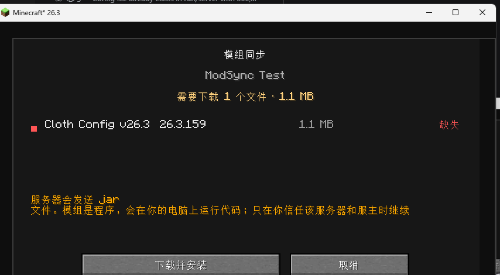
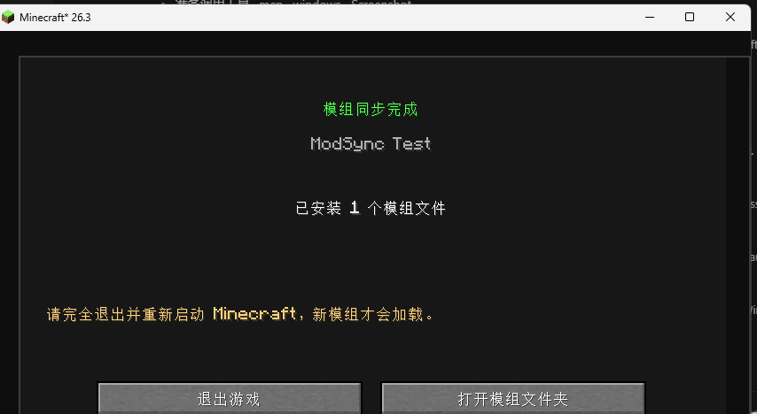
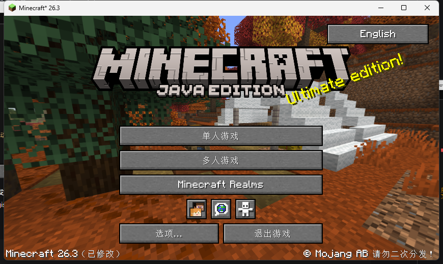

# ModSync for Fabric · 联机模组自动适配

> 装一个 ModSync，剩下的模组让它自己下。

## 版本选择

| 加载器 | Minecraft | 文档 | 说明 |
|---|---|---|---|
| Fabric | 26.3 / 26.2 | 本页 | 配置阶段自动同步，体验最完整 |
| Forge | 1.20.1 | [forge/README.md](../forge/README.md) | 进服前 HTTP 同步（方案 A） |
| NeoForge | 1.21.1 | [neoforge/README.md](../neoforge/README.md) | 进服前 HTTP 同步（方案 A） |

Forge / NeoForge 在 login 阶段就会检查模组列表，**不能**沿用 Fabric 的“配置阶段自动同步”；它们采用“先同步、再进服”的独立实现。

---

ModSync 是一个联机模组同步工具，用来解决联机时最常见的尴尬：**房主装了模组，朋友没装，或者版本对不上，进服就报错/被踢/崩溃。** 本页主要介绍 Fabric 版的配置阶段自动同步；Forge 1.20.1 和 NeoForge 1.21.1 的“进服前同步”见上面的版本表。

它会在客户端还在 **配置阶段（configuration phase）**、服务器还没发送注册表数据之前，先把房主的模组清单发给客户端；客户端确认差异后，可以通过同一条 Minecraft 连接把缺少的 jar 下载下来、校验 SHA-256、备份旧文件并安装。装完退出重启，再进服即可。

> 关键点：不需要额外开 HTTP 端口，不需要网盘，不需要把整合包发给朋友。协议走的是 Minecraft 自己的连接，所以对局域网、内网穿透、联机模组开的房间都更友好。





---

## 它到底怎么工作

1. 房主启动世界/服务器，ModSync 扫描 `mods/` 里可以被共享的顶层 jar，生成清单（模组 id、版本、文件名、大小）。
2. 客户端加入时，服务端在 **vanilla 配置流程开始前**插入一个配置任务，把清单发给客户端。
3. 客户端在本地按 `mod id + version` 对比：
   - 都存在且版本一致 → 直接放行，正常进服；
   - 缺失 / 版本不符 → 暂停配置流程，显示审核界面。
4. 玩家点击“下载并安装”后，客户端在**同一条连接**上请求文件；服务端按 32 KB 分块发送，客户端边收边写临时文件。
5. 每个文件结束后服务端发送 SHA-256；客户端全部收完后统一校验，再原子移动到 `mods/`，旧文件移动到 `mods/.modsync-backup/<时间>/`。
6. 服务端发送完成消息并断开这条“同步连接”，客户端提示完全退出并重启。重启后新模组加载，再正常进服。

因为整个交换发生在**注册表数据之前**，所以即使客户端缺的是内容模组（方块、物品、维度），也不会先被注册表不匹配踢掉。

更细的时序、报文和安全设计见 [ARCHITECTURE.md](ARCHITECTURE.md)。

---

## 主菜单语言切换

标题界面右上角新增语言按钮，点击会弹出一个 **16 种语言**的列表；选中后立即切换**整个 Minecraft 的语言**，ModSync 的界面也会跟着切换。



支持中文、English、日本語、한국어、Deutsch、Français、Español、Português、Italiano、Русский、Türkçe、Polski、Nederlands、ไทย、Bahasa Indonesia、Tiếng Việt。

---

## 已实现的功能

- 配置阶段清单交换，不依赖额外端口或外部服务。
- 按模组 id + 版本做差异判断，区分：已同步、缺失、版本不符、部分缺失、可选。
- 分块传输、总大小/单文件大小限制、SHA-256 校验。
- 临时目录 staging，校验全部通过后才安装。
- 覆盖/替换前自动备份到 `mods/.modsync-backup/`。
- 客户端明确同意后才下载，默认**绝不自动安装**。
- 服务端只共享 `mods/` 下的顶层 `.jar`，不会共享配置、存档、账号信息。
- 中文/英文界面，跟随游戏语言。
- `/modsync status|list|reload` 管理命令。
- 服务端/客户端 JSON 配置。
- 针对 Fabric 26.3 的实机联机验证；另提供 26.2 构建。

---

## 安装

### 版本

| Minecraft | Fabric Loader | Fabric API | 产物 |
|---|---|---|---|
| **26.3** | 0.20.1 | 0.165.0+26.3 | `build/libs/modsync-26.3-1.3.0.jar` |
| 26.2 | 0.19.5+（推荐 0.20.1） | 0.161.0+26.2 | `build/libs/modsync-26.2-0.1.0.jar` |

- 需要 **Java 25**（Minecraft 26.x 的运行时要求）。
- 26.3 已做实机联机验证；26.2 只做了编译验证，未做完整联机回归。
- 这是 **Fabric** 模组，不适用于 Forge / NeoForge。

### 房主和客人都要装

1. 安装 Fabric Loader（26.3 对应 0.20.1）和 **Fabric API**。
2. 把对应版本的 `modsync-*.jar` 放进 `mods/`。
3. 房主和客人都要放。ModSync 不能在自己还没加载时把自己下载下来，所以**第一次必须手动装这一个 jar**；之后其他模组才由它同步。

> 客户端还需要事先装好 Fabric API，因为 ModSync 自身依赖 Fabric API。Fabric Loader、Java、Minecraft 本体不会被同步。

### 使用流程

1. 房主正常启动世界并开放局域网，或者启动 Fabric 服务器。
2. 客人从“多人游戏”加入。
3. 如果模组不一致，会出现审核界面：
   - 红色“缺失”、橙色“版本不符”等；
   - 显示需要下载的文件数量和总大小；
   - 显示服务器有、但本地多出来的模组数量（这些不会被自动删除，只提示可能不兼容）。
4. 点击 **下载并安装**。下载完成后会显示“模组同步完成”。
5. 点击 **退出游戏**，重新启动 Minecraft。
6. 再次加入，这次清单一致，直接进服。

如果点“取消”或按 Esc，会断开这次连接，不会修改任何文件。

---

## 配置

配置文件在：

```
config/modsync.json
```

首次启动会自动生成。服务端和客户端共用一个文件，但各取所需。

```json
{
  "server": {
    "enabled": true,
    "shareClientOnlyMods": true,
    "excludeMods": [],
    "maxFileSizeMb": 200,
    "maxTotalSizeMb": 1024,
    "idleTimeoutSeconds": 900
  },
  "client": {
    "enabled": true,
    "backup": true,
    "maxTotalSizeMb": 1024
  }
}
```

| 字段 | 说明 |
|---|---|
| `server.enabled` | 是否允许房主共享模组。关掉后客户端不会收到清单。 |
| `server.shareClientOnlyMods` | 是否共享 `environment: client` 的模组。默认开，因为 Fabric registry sync 可能要求这些登记项；如果你确定不需要，可以关。 |
| `server.excludeMods` | 不共享的模组 id 列表，例如 `["sodium", "iris"]`。 |
| `server.maxFileSizeMb` | 单个 jar 的大小上限。 |
| `server.maxTotalSizeMb` | 一次同步的总大小上限。 |
| `server.idleTimeoutSeconds` | 审核界面停留多久无操作后断开。客户端每 10 秒发一次 ping，正常情况下不会触发。 |
| `client.enabled` | 客户端是否接受同步。关掉后即使服务端发清单也会直接放行。 |
| `client.backup` | 替换旧 jar 前是否备份到 `mods/.modsync-backup/`。 |
| `client.maxTotalSizeMb` | 客户端允许接收的总大小上限。 |

修改后重启游戏/服务器生效；服务端也可以用 `/modsync reload` 重建清单。

---

## 命令

| 命令 | 权限 | 作用 |
|---|---|---|
| `/modsync status` | 所有人 | 查看是否开启、共享了多少 jar、总大小。 |
| `/modsync list` | 所有人 | 列出最多 20 个共享文件名。 |
| `/modsync reload` | 游戏管理员（gamemaster） | 重新扫描 `mods/` 并生成清单。 |

单人游戏需要开启作弊才能使用命令；联机服务器按权限等级判断。

---

## 安全边界

同步模组本质上就是**从服务器下载并执行代码**，所以这里做了几层限制：

- **必须手动确认**：审核界面点“下载并安装”才会开始传输；没有自动下载开关。
- **SHA-256 校验**：服务端边读边算，客户端收完后校验；不一致的文件不会安装。
- **只写 `mods/`**：文件名会被清洗，只允许单个 `.jar` 文件名；服务端也只读取 `mods/` 真实路径下的文件，防止路径穿越/符号链接。
- **先 staging 再安装**：全部文件校验通过后才移动到 `mods/`；失败不会留下半安装状态（极端情况下可能已安装部分文件，备份目录可用于恢复）。
- **备份**：被替换的旧 jar 会移动到 `mods/.modsync-backup/<时间>/`。
- **不共享隐私数据**：清单只包含模组元数据和 jar 大小；不会读取配置文件、存档、日志、账号 token。
- **大小限制**：单文件和总大小都有上限，客户端也独立限制，避免恶意服务器撑爆磁盘。

仍然必须强调：**只加入你信任的服务器**。服主理论上可以给你任何 jar，而 jar 就是程序。ModSync 不能替你判断一个模组是否安全。

另外，请遵守每个模组的许可证：只共享允许再分发的模组。ModSync 是传输工具，不绕过付费/授权限制；如果你不确定某个模组能否传给朋友，请把它加入 `server.excludeMods`。

---

## 已知限制

1. **双方都要先有 ModSync**。没有 ModSync 的客户端不会自动获得它；这是“引导问题”，只能手动装一次。
2. **只支持 Fabric**。Forge 在 login 阶段就会做模组列表校验，配置阶段方案不适用；NeoForge 也未适配。
3. **Fabric API 不会被同步**。ModSync 依赖它，所以客户端必须先装；Fabric Loader / Java / Minecraft 本体也不会。
4. **需要重启**。下载的 jar 不能在当前 JVM 里安全加载；同步完成后必须完全退出并重启。
5. **只共享 `mods/` 下的顶层 jar**。整合包内置（jar-in-jar）的模组会随父 jar 一起走；放在其他目录、或开发环境 classpath 上的模组不会被共享。
6. **不会自动删除“多余模组”**。客户端本地多出来的模组只提示、不处理；如果需要严格一致，请手动清理。
7. **同 id 同版本但内容不同的 jar 不会在清单阶段被发现**。清单只比对 id/version；传输阶段有 SHA-256，但不会主动重下所有同版本文件。
8. **极端大包/慢网**：默认单文件 200 MB、单次 1 GB、15 分钟无操作超时；可通过配置调整。超大整合包建议先用启动器同步整合包。
9. **服务器/客户端在配置阶段被其他模组提前踢掉**：如果某个模组在 ModSync 任务之前就崩溃或修改了 login/config 协议，ModSync 来不及介入。
10. **未做 macOS/Linux 实机验证**。代码使用 Java NIO 和 Minecraft 自带网络，理论上跨平台；GUI 使用游戏内 Screen，不依赖 Swing。

---

## 从源码构建

前置：

- JDK 25
- Gradle Wrapper 9.8.2（仓库已带）
- 能访问 Fabric Maven / Mojang 资源

### 26.3

```bash
./gradlew build
```

产物：`build/libs/modsync-26.3-1.3.0.jar`

### 26.2

```bash
./gradlew build \
  -Pminecraft_version=26.2 \
  -Pfabric_api_version=0.161.0+26.2 \
  -Pminecraft_dependency=~26.2
```

Windows PowerShell 建议给每个 `-P` 参数加引号，避免 `+` 和点号被 shell 误解析：

```powershell
.\gradlew.bat build "-Pminecraft_version=26.2" "-Pfabric_api_version=0.161.0+26.2" "-Pminecraft_dependency=~26.2"
```

> 切换版本会触发 Loom 重新下载对应 Minecraft 依赖；两个版本的产物文件名带版本号，不会互相覆盖。

### 测试

```bash
./gradlew test
```

当前有 15 个单元测试：协议编解码、清单 JSON、差异计算、文件名清洗。

---

## 项目结构

```
src/main/java/dev/modsync/
  ModSync.java                 入口
  ModSyncConfig.java           JSON 配置
  net/SyncPayload.java         配置阶段自定义 payload
  protocol/                    与 Minecraft 无关的二进制协议
  manifest/                    清单模型 + Gson
  plan/                        本地/远程差异计算
  util/                        SHA-256、文件名清洗、大小格式化
  server/                      清单扫描、配置任务、分块发送、命令
src/client/java/dev/modsync/client/
  ModSyncClient.java           客户端入口 + IO 线程
  ClientSyncController.java    清单接收、状态机入口
  ClientSession.java           审核/下载/校验/安装状态
  LocalMods.java               本地模组扫描
  ModInstaller.java            staging → 备份 → 安装
  SyncScreen.java              审核界面
  SyncProgressScreen.java      下载进度
  SyncResultScreen.java        完成/失败界面
src/test/java/                 单元测试
docs/                          截图
```

---

## 验证记录

### 关键修复：先于 Fabric registry sync

Fabric API 的 `fabric-registry-sync-v0` 也会在 `BEFORE_CONFIGURE` 里排一个任务。它比普通模组先注册，所以默认顺序是：

```text
Fabric registry sync -> ModSync -> 客户端被踢
```

之前的版本会看到：

```text
接收到 N 个本客户端无法识别的注册表项
可能与以下注册表项命名空间相关：quickshulker, xaerominimap, xaeroworldmap
```

现在 ModSync 会把自己的配置任务**插到队列最前面**：

```text
ModSync -> 玩家同意/下载/重启 -> Fabric registry sync
```

同时 `shareClientOnlyMods` 默认改为 `true`，否则 `xaerominimap` / `xaeroworldmap` / `quickshulker` 这类只在客户端声明的模组不会被共享，仍然会被 registry sync 拒绝。

> 如果你之前已经生成过 `config/modsync.json`，请把里面的 `"shareClientOnlyMods"` 改成 `true`，或者删掉配置文件让 ModSync 重新生成。

### 联机测试

在 Windows + Minecraft 26.3 + Fabric Loader 0.20.1 上做过完整联机验证：

- 服务端 `mods/` 放 `cloth-config-fabric-26.3.159.jar`（1,135,009 字节）；
- 客户端 `mods/` 为空，加入服务器；
- **服务端日志确认 ModSync 清单先于 registry sync 发送**，客户端没有出现 `unknown registry entries`；
- 客户端显示审核界面，点击下载后安装 `cloth-config.jar`；
- 客户端日志：`Installed ...cloth-config.jar`；
- 服务端日志：`Client needs 1 file(s); holding configuration until consent` → `Client consented` → `ModSync finished`。

另外用正式打包的 `modsync-26.3-1.3.0.jar` 在独立 Fabric 26.3 服务端上启动，日志确认 `ModSync sharing 1 jar(s)`。

26.2 只做了编译验证，未做完整联机回归。

---

## License

MIT，见 [LICENSE](LICENSE)。
