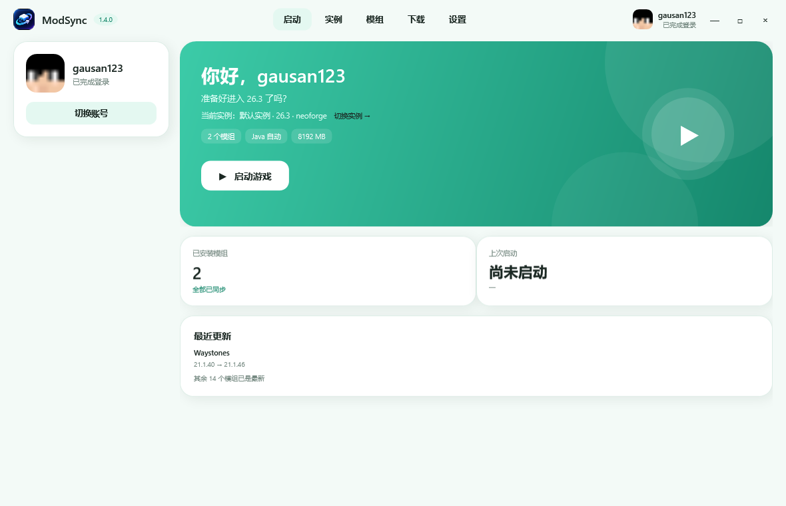

# ModSync Launcher · 新界面

薄荷绿、圆角、简洁版启动页。旧的 PCL 风格页面保留在 `MainWindow.xaml`，没有删除。



## 特性

- 自定义无边框窗口；
- 顶部胶囊导航：启动 / 模组 / 下载 / 设置；
- 左侧账号卡片：头像、用户名、账号类型；
- 当前实例卡片；
- 服务器同步状态；
- 大尺寸薄荷绿启动卡片；
- 启动按钮、模组数量、Java、内存信息；
- 统计卡片：模组 / 服务器 / 上次启动；
- 快速进入服务器、最近更新；
- 全部使用圆角卡片和柔和阴影。

## 运行

```powershell
dotnet run --project launcher-wpf/ModSyncLauncher.csproj -c Release
```

## 账号

点击顶部账号或左侧“切换账号”可以：

- 修改用户名；
- 选择离线 / 微软账号类型；
- 选择本地 PNG / JPG / WebP 头像；
- 保存到：
  ```text
  %APPDATA%\ModSyncLauncher\account.json
  ```

## 多实例

同一个 Minecraft 版本可以创建多个实例：

```text
实例 A：5 个模组
实例 B：6 个模组
```

每个实例有独立模组目录：

```text
%APPDATA%\ModSyncLauncher\instances\<id>\mods
```

在启动页的“当前实例”下拉框切换实例，模组列表会跟着切换。  
点“＋ 新建实例”可以创建新的空实例，ModSync 会自动装进该实例。

## 微软登录

账号窗口里点“使用微软账号登录”：

- 使用微软设备码登录；
- 自动打开浏览器；
- 登录后获取 Minecraft 用户名、UUID 和皮肤头像；
- 正版启动会使用登录 token。

## 下载页

已经接入真实 Modrinth：

- 按加载器和 Minecraft 版本搜索；
- 显示真实结果和下载量；
- 一键安装；
- 自动递归安装 required 前置；
- SHA-512 校验；
- 安装到 `.minecraft/mods`。

实测搜索 `sodium` 返回 18 个结果，安装 `Jade` 成功。

## 模组页

读取 `.minecraft/mods`，并且固定显示：

```text
ModSync 1.4.0  必装
```

已安装时显示“必装 · 已安装”，未安装时显示“必装 · 未安装”。

每个普通模组支持：

- 禁用 / 启用；
- 删除；
- 从 Modrinth 查找更新并安装；
- A → Z 排序；
- 只有“检查更新”发现新版本时才显示更新按钮。

模组目录按版本隔离：

```text
.minecraft/versions/<版本>/mods
```

切换版本时，模组列表会跟着切换。

## 启动游戏

启动页会读取：

```text
%APPDATA%\.minecraft\versions
```

选择一个本地版本后，点击“启动游戏”：

- 自动补齐客户端 jar；
- 自动补齐 libraries；
- 自动补齐 assets；
- 自动解压 natives；
- 自动选择 Java；
- 使用当前账号以离线模式启动；
- 使用 `javaw.exe`，不弹出 CMD 窗口；
- 启动状态和进度显示在启动页。

实测已启动 **Minecraft 26.3**。

## 当前状态

- 账号名称和头像可以本地配置；
- 本地版本启动已经可用；
- 还没有接入微软正版登录；
- 启动时使用离线账号。

旧 PCL 风格界面仍保留：

```text
MainWindow.xaml
```

如需切回旧版，把 `App.xaml` 的 `StartupUri` 改成 `MainWindow.xaml`。

## 下一步

- 接入真实账号和头像；
- 接入 Modrinth 搜索；
- 接入服务器同步；
- 接入启动游戏。
